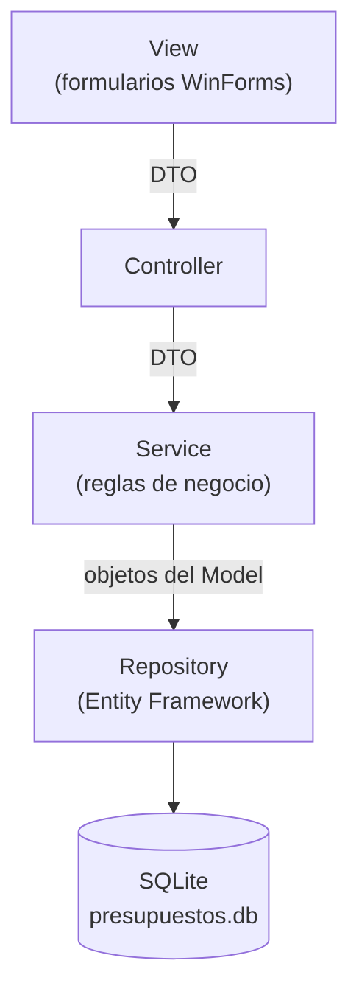
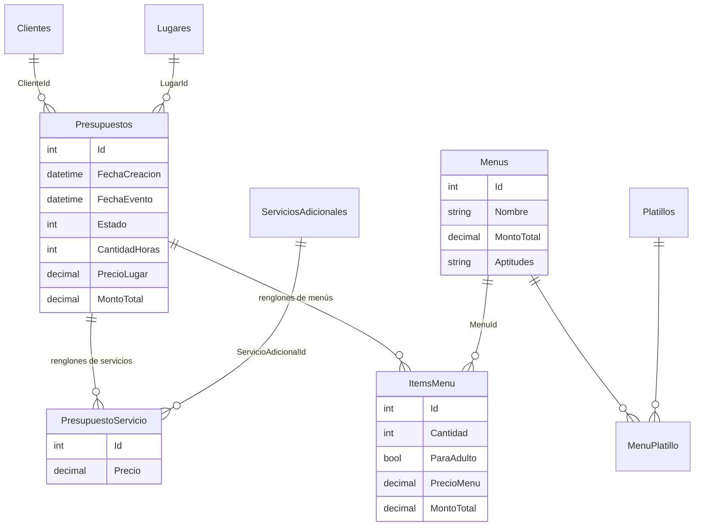

# Calculador de Presupuestos para Eventos

Aplicación de escritorio (WinForms, .NET 10) para armar presupuestos de eventos: se elige cliente, lugar,
servicios adicionales y menús, y el monto se calcula al instante. Los datos se guardan en una base SQLite
con Entity Framework Core.

Esta guía explica cómo está organizado el código para leerlo más fácil.

---

## Cómo ejecutarlo

1. Abrir `Luciano_Integrador_Evaluativo_Final.slnx` en Visual Studio y ejecutar (F5).
2. La primera vez se crea la base `presupuestos.db` al lado del ejecutable y se cargan datos de ejemplo
   (2 clientes, 2 lugares, 2 servicios, 2 platillos y 2 menús).

Para empezar con la base vacía, cerrar la app y borrar `presupuestos.db` (en `bin\Debug\net10.0-windows`).

---

## Arquitectura en capas

Cada pedido del usuario baja por las capas y la respuesta vuelve por el mismo camino. Cada capa solo
conoce a la de abajo.



| Capa | Carpeta | Qué hace | Qué NO hace |
|---|---|---|---|
| **View** | `View/` | Muestra pantallas, lee lo que escribe el usuario y arma un DTO. | No calcula ni valida reglas de negocio. |
| **Controller** | `Controller/` | Recibe el pedido de la View y se lo pasa al Service. | No tiene lógica propia. |
| **Service** | `Service/` | Valida, aplica las reglas de negocio y arma los objetos del modelo. | No sabe cómo se guardan los datos. |
| **Repository** | `Repository/` | Guarda y lee de la base de datos. | No conoce reglas de negocio. |
| **Model** | `Model/` | Clases del dominio (Cliente, Presupuesto, Menú...). Algunas tienen lógica propia (calcular su monto, cambiar de estado). | No conoce la base ni las pantallas. |
| **Dto** | `Dto/` | Datos que viajan del formulario al Service, sin id ni lógica. Las relaciones viajan como ids. | — |

---

## Recorrido de un caso: registrar un presupuesto

Seguir este caso es la forma más rápida de entender cómo se conectan las piezas.

1. **`View/PresupuestoForm.cs`** → `btnRegistrar_Click` llama a `ArmarDTO()`, que junta lo cargado
   (fecha, horas, ids de cliente/lugar/servicios y los `ItemMenuDTO`) en un `PresupuestoDTO`.
2. **`Controller/PresupuestoController.cs`** → `RegistrarPresupuesto(dto)` lo pasa al Service.
3. **`Service/PresupuestoService.cs`**
   - `ValidarRegistro(dto)`: fecha no anterior a hoy, horas > 0, al menos un menú.
   - `Construir(dto)`: busca cliente, lugar y servicios en sus repositorios, guarda sus **precios actuales**
     (ver *Precios congelados*), arma los ítems de menú con `ItemMenuService` y calcula el monto.
4. **`Repository/PresupuestoRepository.cs`** → `Agregar(presupuesto)` (heredado de `EfRepository`) lo
   inserta junto con sus renglones; la base le asigna el id.
5. La View refresca la grilla y limpia el formulario.

El monto que se ve "al instante" mientras se completa el formulario usa el mismo `Construir`, pero sin
guardar (`PresupuestoService.CalcularMonto`).

---

## Modelo de datos



| Clase (Model) | Tabla | Notas |
|---|---|---|
| `Cliente` | `Clientes` | Nombre, teléfono y email. |
| `LugarEvento` | `Lugares` | Nombre y precio base. |
| `ServicioAdicional` | `ServiciosAdicionales` | Servicio extra con precio fijo (DJ, decoración...). |
| `Platillo` | `Platillos` | Entrada, principal o postre, con precio. |
| `Menu` | `Menus` + `MenuPlatillo` | Conjunto de platillos; su precio por invitado es la suma de los platillos. Las aptitudes (`Veganos`, `Vegetarianos`, `Celiacos`) se guardan como texto: `"Veganos,Celiacos"`. |
| `Presupuesto` | `Presupuestos` | Apunta a cliente y lugar; guarda `PrecioLugar` y el `MontoTotal`. |
| `ServicioPresupuestado` | `PresupuestoServicio` | Renglón: un servicio del presupuesto con su precio al cotizar. |
| `ItemMenu` | `ItemsMenu` | Renglón: un menú, la cantidad de invitados y el precio por invitado al cotizar. |

**Reglas de borrado** (las aplica la base y también el Service, con un mensaje claro):
- No se puede borrar un cliente, lugar, servicio o menú que use algún presupuesto, ni un platillo que esté
  en algún menú (`RESTRICT`).
- Al borrar un presupuesto se borran sus renglones (`CASCADE`).

---

## Reglas de negocio principales

| Regla | Dónde está |
|---|---|
| Monto = precio del lugar + servicios + (invitados × precio del menú). Las horas no influyen. | `Presupuesto.CalcularMonto` |
| Estados: Nuevo → Enviado → Pagado. Se puede volver de Enviado a Nuevo; Pagado es definitivo. | `Presupuesto.CambiarEstado` |
| Al pasar a Pagado, el lugar no puede estar reservado por otro presupuesto pagado en un horario superpuesto. | `PresupuestoService.ValidarSuperposicion` |
| No se edita un presupuesto pagado ni uno cuyo evento ya pasó. | `PresupuestoService.ValidarEdicion` |
| No se elimina un presupuesto pagado. | `PresupuestoService.EliminarPresupuesto` |
| Validaciones de cada alta (nombre obligatorio, precio > 0, etc.). | `ValidarRegistro` de cada Service |

### Precios congelados

Un presupuesto guarda los precios **del momento en que se cotizó**: `PrecioLugar` en el presupuesto, y el
precio de cada servicio y menú en su renglón (`ServicioPresupuestado.Precio`, `ItemMenu.PrecioMenu`).
Si después sube un precio, los presupuestos ya hechos (su total y su PDF) no cambian. Lo que sí se ve
actualizado son los datos descriptivos, como el nombre o el teléfono.

- **Clonar** (`Presupuesto.ClonarPresupuesto`): crea en memoria un presupuesto nuevo con los mismos datos
  y precios, y se inserta como uno más.
- **Editar** (`PresupuestoService.ActualizarPresupuesto`): vuelve a cotizar con los precios actuales.

### Catálogo y renglones

El modelo separa **lo que se ofrece** de **lo que se cobró**:

| Catálogo (datos vigentes) | Renglón del presupuesto (precio al cotizar) |
|---|---|
| `LugarEvento` | columna `Presupuesto.PrecioLugar` (un solo lugar por presupuesto) |
| `ServicioAdicional` | `ServicioPresupuestado` |
| `Menu` (con sus `Platillo`) | `ItemMenu` |

Las clases del catálogo (`Cliente`, `LugarEvento`, `ServicioAdicional`, `Menu`, `Platillo`) solo tienen sus
datos. Los renglones apuntan al catálogo, guardan el precio de ese momento y saben calcular su monto.

### Polimorfismo: `IItemPresupuesto`

Solo los renglones (`ServicioPresupuestado`, `ItemMenu`) implementan `IItemPresupuesto`: cada uno sabe
describirse, calcular su monto con el precio guardado y copiarse para clonar. `Presupuesto.CalcularMonto`
los recorre sin conocer su tipo, así que un tipo de ítem nuevo se suma sin cambiar ese método.

---

## Base de datos (Entity Framework Core + SQLite)

| Archivo | Para qué |
|---|---|
| `Repository/AppDbContext.cs` | Define las tablas y relaciones (Fluent API). Es un Singleton: toda la app comparte el mismo contexto. |
| `Repository/EfRepository.cs` | Implementa `IRepository<T>` (Agregar, GetTodos, GetPorId, Update, Delete) una sola vez para todas las entidades. |
| `Repository/*Repository.cs` | Un repositorio por entidad. Menú y Presupuesto indican qué datos relacionados cargar (`Include`). |
| `Repository/Migrations/` | Historial del esquema. `Inicial` crea todas las tablas, relaciones y columnas de precios. |
| `Program.cs` | Al iniciar aplica las migraciones pendientes (`Database.Migrate()`) y carga los datos de ejemplo si la base está vacía. |

**Cambiar el modelo de datos** (desde la carpeta del proyecto):

```bash
dotnet tool restore
```

```bash
dotnet ef migrations add NombreDelCambio --output-dir Repository/Migrations
```

La próxima vez que se abra la app, la migración se aplica sola.

---

## Pantallas (View)

| Archivo | Pantalla |
|---|---|
| `MenuPrincipalForm` | Ventana principal con la barra de pestañas. Cada pantalla se crea una vez y se conserva al cambiar de pestaña (no se pierde lo cargado); al volver, relee sus datos (`IPantallaActualizable`). |
| `PresupuestoForm` | Formulario de presupuesto con monto al instante y grilla con las acciones (cambiar estado, editar, clonar, PDF, eliminar). Al hacer clic en una fila (o moverse con las flechas) se muestra ese presupuesto con los campos deshabilitados; "Cerrar vista" devuelve lo que se estaba cargando. |
| `ClienteForm`, `LugarEventoForm`, `ServicioAdicionalForm`, `PlatilloForm`, `MenuForm` | Alta, edición y baja de cada entidad. Clientes, lugares y menús también se abren como ventana aparte desde la opción "+ Agregar nuevo..." de los combos de Presupuestos; platillos, desde el botón de alta de la pantalla de Menús. |
| `Estilo` | Aspecto común de todas las pantallas (colores, botones, grillas, escala). |

Los archivos `*.Designer.cs` los genera Visual Studio a partir del diseñador de formularios.

---

## Otros

- **PDF**: `Service/PresupuestoPdfService.cs`, con la librería PDFsharp 6.2.0.
- **Datos de ejemplo**: `Service/DatosDePruebaService.cs`.
- **Diagramas UML**: `Documentacion/` (archivos de UMLet, `.uxf`).
